# Ledger

A crash-safe gateway for AI agents: it records every tool call and model call before it runs, so a retry never sends the same email twice, and any run can be stepped through, forked onto another model, or replayed as a regression test.

[](https://www.rust-lang.org)
[](https://tokio.rs)
[](https://modelcontextprotocol.io)
[](https://www.postgresql.org)
[](https://opentelemetry.io)
[](https://azure.microsoft.com/products/container-apps)
[](LICENSE)
[](https://github.com/CarlGergi/Ledger/actions/workflows/ci.yml)

<p align="center">
  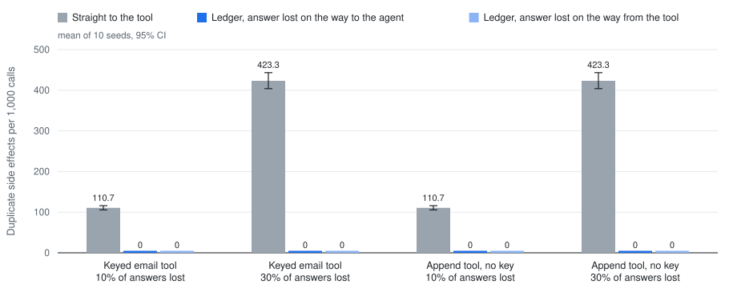
</p>
<p align="center"><sub>Duplicate side effects per 1,000 calls when answers are lost after the tool has run. Mean of 10 seeds, 95% bootstrap CI.</sub></p>

## At a glance

| What was measured | Without Ledger | With Ledger | Reproduce |
| --- | --: | --: | --- |
| Duplicate side effects per 1,000 calls, 10% of answers lost after the tool ran | 110.7 [105.6, 116.0] | **0** | `make bench-duplicates` |
| Duplicate side effects per 1,000 calls, 30% of answers lost | 423.3 [403.9, 443.3] | **0** | `make bench-duplicates` |
| Unsafe calls whose outcome was lost, 30% loss, per 1,000 calls | repeated blindly | **298.0 flagged for a person, 0 repeated** | `make bench-duplicates` |
| Time until another copy serves a session after a clean stop (SIGTERM) | | **5 to 7 ms** median (a killed copy: `lease_secs` + 13 to 14 ms) | `make bench-takeover` |
| Restarts on Azure with a session open | | **5 of 5 with 0 refused calls** | `deploy/azure/demo.sh` |
| Simulated runs with crashes, paused copies and lost messages | | **1,000,000 seeds, 0 invariant violations** | `make simulate` (10,000 seeds) |
| Bugs deliberately injected into the gateway and store | | **122 of 122 caught by a named test** | `make breakage` |
| Latency per call, median, one call at a time | 0.16 to 0.18 ms | **1.79 to 2.05 ms** (1.6 to 1.9 ms added) | `make bench-overhead` |

Every number comes from a command in this repository. `make reproduce` rebuilds the benchmark, demo, replay and simulation numbers and runs the test suite. Four checks run on their own, because of what they cost: the breakage check (about 3.5 hours), the soak, the overhead benchmark (it needs a quiet machine), and the Azure demo (it costs money: CA$0.04 when it was recorded). Intervals are 95% confidence intervals; [Results](#results) gives the machine, its load and the method for each.

## Overview

An agent that retries a tool call cannot tell whether the first attempt ran: if the answer was lost on the way back, a retry sends a second email or makes a second payment. Ledger is a gateway that sits between any MCP agent and its tool servers (and, optionally, its OpenAI-compatible model) and writes every call to an append-only PostgreSQL log before forwarding it and every answer before returning it. A retry is answered from the log, or re-run with the same idempotency key, or, when nothing makes a second run safe, flagged for a person instead of repeated. Several copies of the gateway can share the log, with leases and fencing tokens so that a paused copy can never write after another has taken over. Because the log holds everything the agent saw, a run can be inspected step by step in VS Code, forked at any step onto another model, or replayed against a new model to find the first step where its behaviour changes.

## Architecture

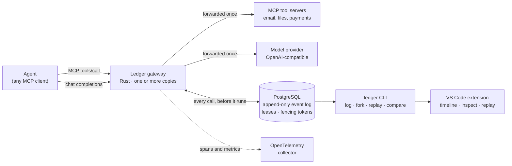

| Component | Technology | Why |
| --- | --- | --- |
| Gateway (`crates/ledger-gateway`) | Rust 1.99, Tokio, axum, rmcp | It parses untrusted input on every call and must neither crash nor pause; Rust gives memory safety without garbage-collection pauses. rmcp is the official Rust MCP SDK. |
| Event log (`crates/ledger-store`) | PostgreSQL 17, sqlx | Real transactions keep the correctness argument short: one statement both claims the next sequence number and checks the writer's fencing token. Triggers refuse updates and deletes, so history cannot be rewritten. |
| Leases and fencing | Rows in the same database, its clock | Every copy already shares the database, so its clock is the one clock they all agree on. |
| Effect policy | MCP tool annotations, a TOML override file | Tools say whether they are read-only, idempotent or destructive; the override file wins because those are only claims. |
| Model proxy | axum, OpenAI-compatible chat completions | The same log then holds what the model was asked and the tool calls that followed, in order. |
| Simulator (`crates/ledger-sim`) | The real gateway on the in-memory store, one seeded generator, simulated time | Crashes, pauses and lost messages are reproducible: a failing seed replays exactly. A conformance suite holds the in-memory store to the PostgreSQL one. |
| VS Code extension (`vscode`) | TypeScript, the `ledger` CLI as its data source | The extension needs no database driver and shows exactly what the CLI shows. |
| Telemetry | OpenTelemetry over OTLP/HTTP | Spans follow the MCP and generative-AI semantic conventions, so any collector understands them. |
| Deployment (`deploy/azure`, `Dockerfile`) | Docker, Bicep, Azure Container Apps, Azure Database for PostgreSQL | Container Apps sends SIGTERM and probes health, which is what graceful handover needs. |
| Benchmarks and figures (`crates/ledger-bench`, `scripts/figures.py`) | Rust, Python standard library | Benchmarks write raw samples to `results/`; one script draws every figure and computes every interval from them. |
| Email demo (`crates/ledger-tools`) | SMTP with lettre, Mailpit | A real mail server and inbox, locally, with no account. |

### What happens to a call

For each `tools/call`, the gateway does three things in order:

1. It commits the request to the log. If that fails, the call is not forwarded and the agent gets `-32050` (not recorded).
2. It forwards the call to the tool server, once.
3. It commits the answer to the log, then returns it. If that fails, the agent gets `-32051` instead of the result.

So a tool cannot run without a record of the request, and nothing reaches the agent that the log does not hold. The schema enforces the rest: each session's sequence numbers run 1, 2, 3, ... with no gaps even under concurrent calls, a call has at most one final answer, and updates, deletes and truncates are refused.

| Failure | What the agent sees | What the log shows |
| --- | --- | --- |
| The database rejects the request | `-32050`; the tool does not run | Nothing |
| The tool reports failure | The tool's own error result | `tool_error` |
| The tool server rejects the call | The server's JSON-RPC error, unchanged | `rpc_error` |
| The tool server is unreachable, or does not answer in time | `-32052`, outcome unknown | `transport_error` or `timeout` |
| The database rejects the answer | `-32051`; the tool may have run | A request with no answer |
| The gateway is killed mid-call | Connection error | A request with no answer |

A request with no answer means the outcome is in doubt, and the log says so rather than guessing.

### Retries and effect classes

Each tool gets a class that says how safely its calls can be repeated:

| Class | Meaning | A tool gets it by |
| --- | --- | --- |
| `read_only` | Changes nothing | `readOnlyHint: true`, unless it also says `destructiveHint: true` |
| `idempotent` | Repeating it with the same arguments has no further effect | `idempotentHint: true` |
| `keyed` | Repeats with the same key take effect once | Declaring an `idempotency_key` input |
| `at_most_once` | Nothing makes a second run safe | Anything else, including no annotations at all |

A file named by `effect_overrides` in the config corrects what a tool claims, and always wins ([`config/effects.toml`](config/effects.toml) shows the format).

A call counts as a retry only if it identifies the call it repeats and its arguments match (by SHA-256, with object keys sorted): it names the same step (`x-ledger-step` header, or `ledger/step` in `_meta`), or it reuses the same JSON-RPC id in the same transport session. Identical arguments alone never make a retry, because an agent may mean to send the same email twice. A retry then:

- waits, if the call is still running in this copy;
- gets the logged answer, if there is one;
- otherwise finds the call in doubt, and goes by its class: `read_only` and `idempotent` calls run again, `keyed` calls run again with the **same** idempotency key, and anything else is answered with `-32052` and flagged for a person (`ledger in-doubt` lists them). It never runs again.

For a keyed tool, the gateway fills in the key itself, `ledger:<session>:<call>`, the same on every attempt at one call and different for every other call. It replaces any key the agent sent and hides the input from the tool listing, so a model never chooses one.

### Several copies

Copies of the gateway can share one database. Each session belongs to one copy at a time through a lease: a copy takes a session on its first call, every append extends the lease by `lease_secs` (30 by default), and a copy renews it every quarter of `lease_secs` while a call runs. Another copy can take the session only once the lease has expired, and gets a higher fencing token. Every append carries its copy's token and the statement that writes the event checks it, so a copy that was paused past its lease cannot write once another has taken over, however sure it is that it still owns the session.

A copy that takes a session over treats every call left without a final answer as in doubt: unsafe ones are flagged at once, safe and keyed ones wait for a retry to settle them. On SIGTERM a copy stops taking calls, waits up to `shutdown_grace_secs` for running ones to log their answers, then releases its leases, so the next copy takes over in milliseconds instead of waiting out the lease ([measured below](#takeover-after-a-stop)).

Fencing protects the log, not the outside world: a paused copy that already logged a request can still forward it when it wakes. What keeps that safe is the in-doubt rule, since the copy that took over never runs such a call again unless its class says that is safe.

### Model calls, forks and regression replay

Pointed at the gateway (`http://127.0.0.1:7100/v1` with an `x-ledger-session` header, or `/s/<session>/v1`), an OpenAI-compatible client's `POST /chat/completions` is logged the same way: request first (with a hash of the body), then the model, then the reply, which the agent gets rebuilt from the log. With `api_key_env` set, the gateway sends its own key and ignores the agent's; no key is ever logged. Model calls have no side effects, so they are never deduplicated or flagged.

A **fork** (`ledger fork <session> --at <step> [--model ...] [--system-prompt-file ...] [--tools safe|replay|live]`) runs an agent again from any step. Every call before the step, to a tool or the model, is answered from the source's log, so the agent gets there exactly as before and nothing runs twice. From the step on, the model is live; tools follow `--tools`, and by default only read-only tools run, so a fork can explore what a new model would do without sending a second email. A call before the step that the source never made means the agent has gone another way, and the fork refuses it (`-32053`) rather than pretend to replay.

A **regression replay** is a fork at step 1 with every tool answered from the log or turned down. `ledger compare` reports the first step where the two runs act differently, comparing the tool calls made (name and arguments) and the final answer, not the model's wording. `ledger regress` does this for a whole suite of recorded runs and can fail CI on any divergence.

### Telemetry, shutdown and health

Each call is one OpenTelemetry server span (`tools/call <tool>` or `chat <model>`) carrying `ledger.session`, `ledger.seq`, `ledger.effect.class`, `ledger.decision` and `ledger.outcome`, and joins the agent's trace through `traceparent`. Metrics count calls, durations, in-doubt flags, leases and fenced appends. `/healthz` answers 200 while the process is up; `/readyz` answers 200 only while the gateway is not shutting down and its database answers.

## Results

All local measurements are on a Mac17,7 (Apple M5 Max, 18 cores, 36 GB, macOS 27), with PostgreSQL 17 in Docker (OrbStack) on the same machine. The machine was shared with other projects' builds and emulators while most of them ran; the load average is given with each. Counts (duplicates, refusals, faults caught) do not depend on load; times do.

### Duplicate side effects

One agent makes 1,000 calls, one email or one appended line each, and retries a call until it is answered, up to 5 attempts, as agents commonly do. A proxy loses each tool call's answer with a fixed probability, after the tool has run, from a seeded generator. Effects are counted at the tool, never from what the agent believes. Each cell is the mean of 10 seeds (1 to 10) with a 95% bootstrap confidence interval; recorded 2026-11-12.

| Tool | Answers lost | Arrangement | Duplicates | Flagged in doubt | Gave up |
| --- | --: | --- | --: | --: | --: |
| email (keyed) | 10% | Straight to the tool | 110.7 [105.6, 116.0] | | 0 |
| email (keyed) | 10% | Ledger, answer lost on the way to the agent | **0** | 0 | 0 |
| email (keyed) | 10% | Ledger, answer lost on the way from the tool | **0** | 0 | 0 |
| email (keyed) | 30% | Straight to the tool | 423.3 [403.9, 443.3] | | 2.1 [1.4, 2.8] |
| email (keyed) | 30% | Ledger, answer lost on the way to the agent | **0** | 0 | 2.1 [1.4, 2.8] |
| email (keyed) | 30% | Ledger, answer lost on the way from the tool | **0** | 0 | 2.1 [1.4, 2.8] |
| append (no key) | 10% | Straight to the tool | 110.7 [105.6, 116.0] | | 0 |
| append (no key) | 10% | Ledger, answer lost on the way to the agent | **0** | 0 | 0 |
| append (no key) | 10% | Ledger, answer lost on the way from the tool | **0** | 99.6 [95.3, 103.9] | 99.6 [95.3, 103.9] |
| append (no key) | 30% | Straight to the tool | 423.3 [403.9, 443.3] | | 2.1 [1.4, 2.8] |
| append (no key) | 30% | Ledger, answer lost on the way to the agent | **0** | 0 | 2.1 [1.4, 2.8] |
| append (no key) | 30% | Ledger, answer lost on the way from the tool | **0** | 298.0 [288.2, 307.4] | 298.0 [288.2, 307.4] |

How to read it: straight to the tool, every lost answer becomes a duplicate. Through Ledger, an answer lost on the way to the agent is served from the log on the retry. A keyed call whose answer was lost on the way from the tool runs again with the same key, which the tool honours. An unkeyed call in that position may or may not have run, so Ledger flags it and tells the agent the outcome is unknown: those are the "gave up" calls, exactly as many as were flagged. The 2.1 calls that gave up elsewhere at 30% lost five answers in a row (expected: 0.3⁵ × 1,000 = 2.4). No call went missing in any of the 120 runs.

The benchmark opens a TCP connection per request, as the MCP HTTP client does, and on macOS that can exhaust the 16,384 local ports. It waits whenever the machine has more than 8,000 TCP sockets, and treats a run that still fails to connect to a local server as invalid rather than counting the failure.

### Takeover after a stop

Two `ledger serve` processes share the database. The first takes a session and is then killed (SIGKILL) or stopped (SIGTERM); the second tries to take the session every 10 ms. Ten trials per row, median with a 95% order-statistic confidence interval. Recorded 2026-11-13 by `make reproduce`, load average 4.3.

<p align="center">
  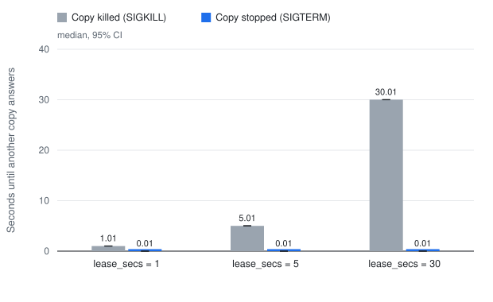
</p>
<p align="center"><sub>Seconds until another copy serves the session. Median of 10 trials, 95% CI.</sub></p>

| `lease_secs` | Copy killed: median s [95% CI] | Copy stopped: median ms [95% CI] |
| --: | --: | --: |
| 1 | 1.014 [1.006, 1.016] | 5 [5, 6] |
| 5 | 5.013 [5.007, 5.018] | 6 [5, 7] |
| 30 | 30.013 [30.007, 30.022] | 7 [5, 10] |

A killed copy cannot say goodbye, so its sessions wait for the lease to expire: the wait is `lease_secs` plus 13 to 14 ms. A stopped copy releases its leases after its running calls have logged their answers, and the next copy takes over within milliseconds, whatever the lease length.

### Overhead

One agent makes 1,000 calls one after another to a real `read_file` tool, after 100 to warm up, first straight to the tool and then through Ledger, which writes each call and its answer to PostgreSQL. Then 16 agents make 100 calls each at once, for calls per second. Every call opens a TCP connection, as the MCP HTTP client does: one straight to the tool, two through Ledger. Four runs on 2026-11-13 on the Mac above with PostgreSQL in its VM, on a quiet machine: load average 2.5 to 3.7 over the last minute.

<p align="center">
  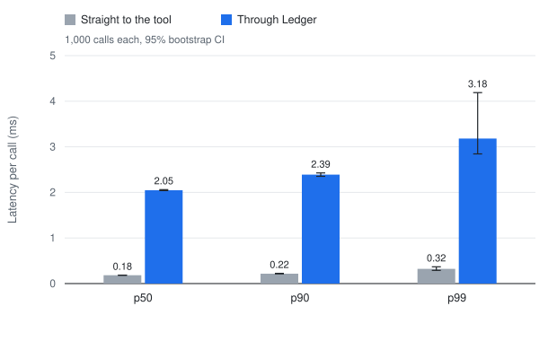
</p>
<p align="center"><sub>Latency per call in run 4: 1,000 calls each, 95% bootstrap CI.</sub></p>

| Run | Straight to the tool, p50 ms | Through Ledger, p50 / p90 / p99 ms | Added by Ledger, p50 / p99 ms | Through Ledger, median of calls 1 to 100 / 901 to 1,000, ms | Calls per second through Ledger, 16 agents |
| --: | --: | --: | --: | --: | --: |
| 1 | 0.16 | 1.98 / 2.33 / 3.98 | 1.82 / 3.69 | 1.85 / 1.95 | 926 |
| 2 | 0.16 | 1.79 / 2.18 / 3.27 | 1.63 / 3.07 | 1.88 / 1.71 | 1,409 |
| 3 | 0.17 | 2.02 / 2.29 / 3.02 | 1.86 / 2.73 | 2.11 / 1.94 | 1,191 |
| 4 | 0.18 | 2.05 / 2.39 / 3.18 | 1.86 / 2.86 | 2.15 / 1.99 | 897 |

Straight to the tool, the 16 agents made 19,680 to 20,212 calls per second. Calls per second through Ledger varies more from run to run than latency does, because every call through Ledger waits for two commits to PostgreSQL in a VM.

Recognising a retry used to read the whole session, so a call cost more the longer its session ran. It now reads only the events that decide it, through indexes, and the same benchmark shows the difference:

| | Before: 2026-11-12, a busy machine (load 7.8 to 12) | After: 2026-11-13, a quiet machine (load 2.5 to 3.7) |
| --- | --: | --: |
| Through Ledger, p50 | 4.60 to 6.68 ms | 1.79 to 2.05 ms |
| Through Ledger, p99 | 10.91 to 13.42 ms | 3.02 to 3.98 ms |
| Median of a session's calls 1 to 100 | 3.08 to 4.46 ms | 1.85 to 2.15 ms |
| Median of its calls 901 to 1,000 | 6.04 to 8.42 ms | 1.71 to 1.99 ms |
| Calls per second through Ledger, 16 agents | 528 to 828 | 897 to 1,409 |
| Straight to the tool, p50 | 0.19 to 0.26 ms | 0.16 to 0.18 ms |

Each side is four runs. Both the code and the load changed between them, so the drop in absolute latency mixes the two. The flat cost within a session is the lookup's own: a session's early and late calls are measured in the same run, under the same load, and no longer differ. One more change: the benchmark waits between phases for closed connections to free their ports, and before 2026-11-13 it never did, because it counted them with `netstat`, which printed nothing when started from a program on this Mac. It now counts them with a sysctl.

### The email demo

`make demo-email` sends real email over SMTP into [Mailpit](https://mailpit.axllent.org), a local mail server with an inbox page. One agent sends one email and retries with a fresh connection when no answer comes; a proxy forwards the first attempt, lets the email go out, and loses the answer. Three runs, counting the emails in the inbox:

| Run | The agent | Emails in the inbox |
| --- | --- | --: |
| Straight to the tool | Answered after 2 attempts | **2** |
| Through Ledger, answer lost on the way to the agent | Answered after 2 attempts | **1** |
| Through Ledger, answer lost on the way from the tool | Answered after 2 attempts | **1** |

<p align="center">
  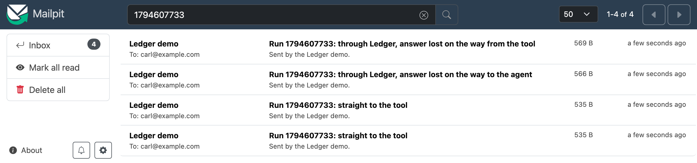
</p>
<p align="center"><sub>The Mailpit inbox after the demo: two identical emails without Ledger, one per run with it.</sub></p>

SMTP has no idempotency key, so the example email tool keeps its own while it runs, the way mail APIs do. Ledger gives it the same key on the retry, and the tool sends nothing new. The repository also has a tool server for AgentMail's API (`make demo-agentmail`); it is tested against a local stand-in that keeps AgentMail's documented key rules, but has not been run against the real service.

### Debugging a run in VS Code

<p align="center">
  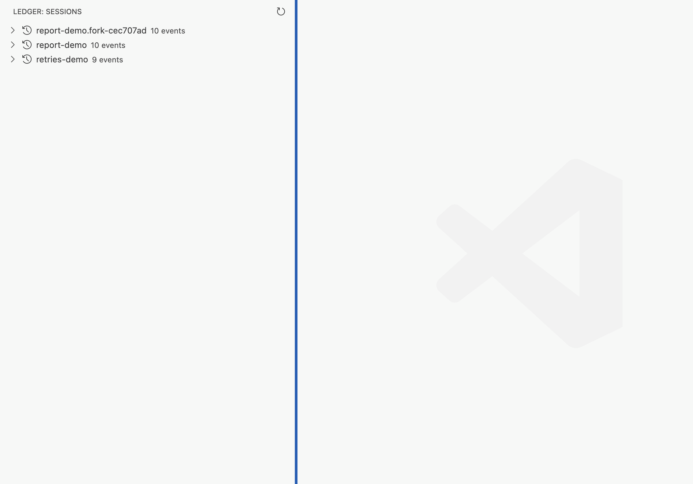
</p>
<p align="center"><sub>Clicking through a recorded session: inspect two calls, then replay the session one event at a time.</sub></p>

The extension reads the log through the `ledger` command. These are screenshots of VS Code 1.99 with the extension installed, captured by `make screens`, which records three sessions with the real gateway, tool servers and scripted model, clicks through them, and crops each picture to the Ledger view and what it opens. `retries-demo` is the case Ledger exists for: an email whose answer was lost on the way to the agent, and an append whose answer was lost on the way from the tool. `report-demo` is a scripted model writing and emailing a report, and the third session is a fork of it.

<p align="center">
  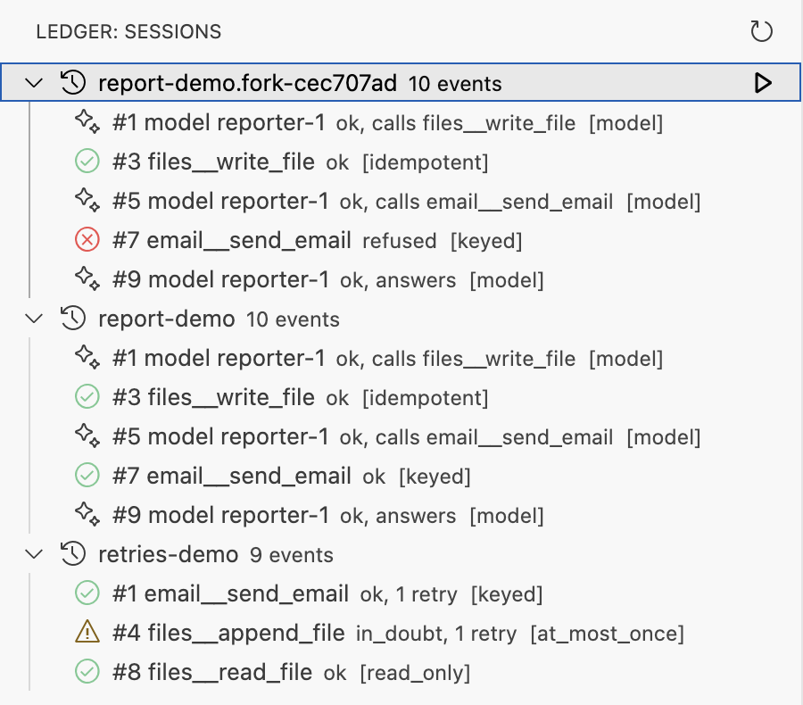
</p>
<p align="center"><sub>The timeline: every session and its calls, each with its status, retries and effect class.</sub></p>

<p align="center">
  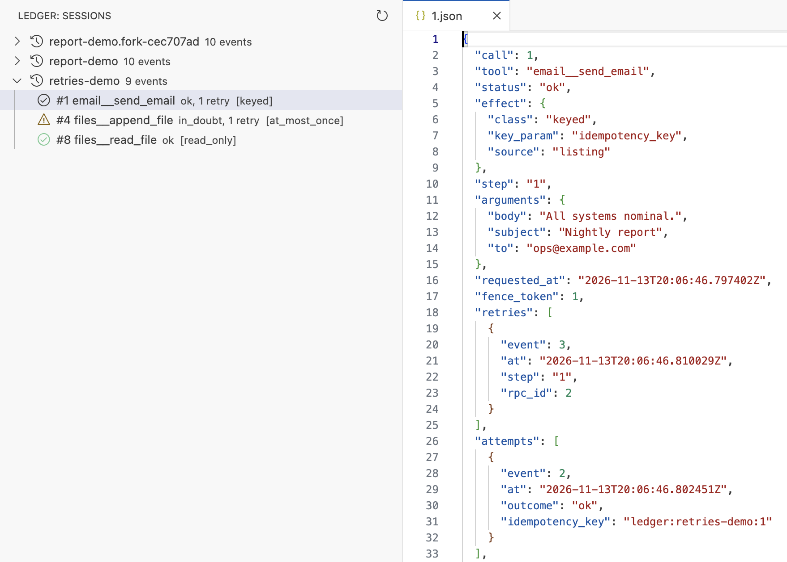
</p>
<p align="center"><sub>A blocked duplicate: the email was asked for twice and sent once, with one retry, one attempt and one key.</sub></p>

<p align="center">
  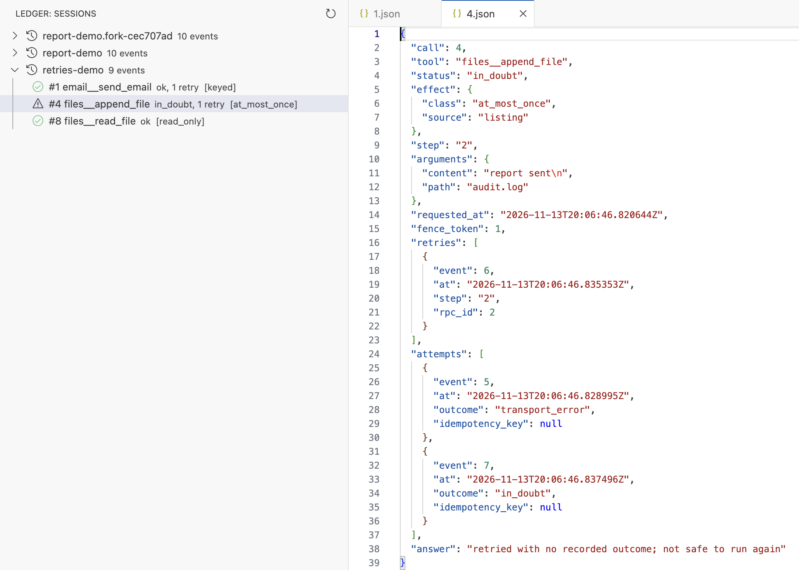
</p>
<p align="center"><sub>Outcome unknown: the append may have run and takes no key, so its retry was flagged for a person, not run.</sub></p>

<p align="center">
  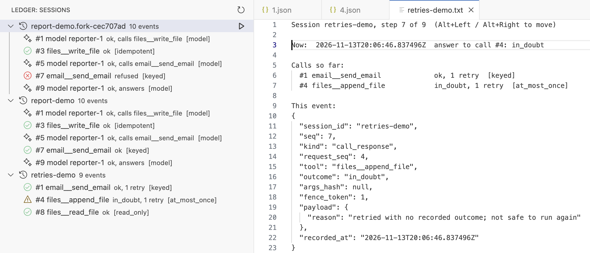
</p>
<p align="center"><sub>Replay at step 7 of 9, where the append was flagged, with every call as it stood then.</sub></p>

<p align="center">
  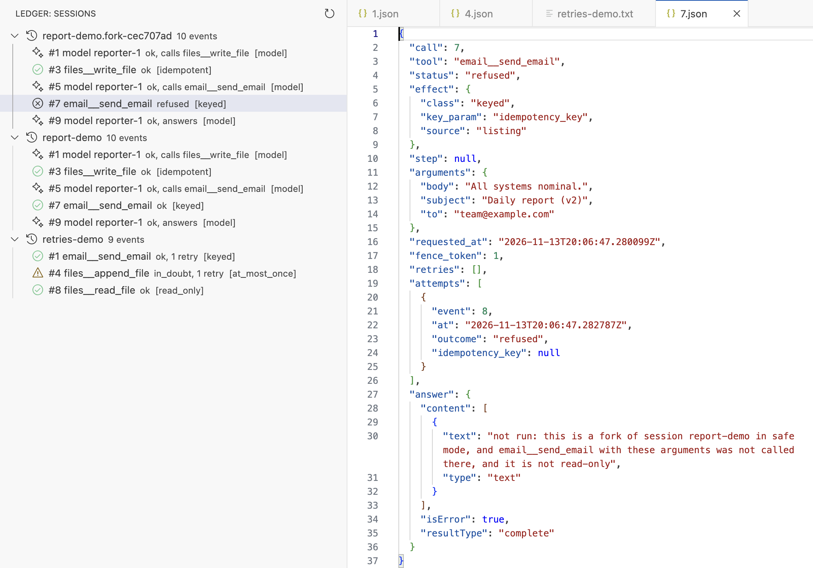
</p>
<p align="center"><sub>A fork at step 5 onto <code>reporter-2</code>: earlier calls come from the log, and its new email is turned down.</sub></p>

### On Azure

`deploy/azure/demo.sh` deployed the gateway, with the example file tool server and Azure Database for PostgreSQL (Burstable B1ms), to Azure Container Apps in Canada Central on 2026-11-12, measured it from the Mac above over the internet, and stopped and started it with a session open. The resource group was deleted the same day; `az` confirmed that no resource group and no resource remained.

Latency, 200 calls each, one at a time, each over a new TCP and TLS connection as the MCP client makes them. `/healthz` touches neither the log nor a tool, so the difference is what the gateway, its two commits to PostgreSQL and the tool add:

| Request | p50 ms | p90 ms | p99 ms | max ms |
| --- | --: | --: | --: | --: |
| `/healthz` | 59.2 | 116.6 | 209.1 | 527.2 |
| `files__read_file` through Ledger | 70.8 | 128.5 | 149.9 | 297.9 |

An append, then the agent asking again for the same step: 69.1 ms, then 73.0 ms with the same answer, and one line in the file.

Stop and start with a session open, five trials:

| Trial | Last answer before the stop to first answer after the start (s) | Stop took (s) | Start to first answer (s) | Calls refused |
| --: | --: | --: | --: | --: |
| 1 | 19.2 | 3.8 | 15.4 | 0 |
| 2 | 5.9 | 3.9 | 2.0 | 0 |
| 3 | 7.1 | 4.7 | 2.4 | 0 |
| 4 | 6.9 | 4.7 | 2.3 | 0 |
| 5 | 12.1 | 9.6 | 2.5 | 0 |

No call was refused: each stopping copy released its session, so the new copy served it at once rather than after the 30-second lease. The time is the platform stopping and starting containers. The first start took longer (15.4 s) than the rest; the container logs show the new copy starting, but also that the copy it replaced logged no "shutting down" line, which the other twelve stops in the logs all did. Why is not known.

The deployment step took 384 s, building the image locally. **Cost: CA$0.035** charged to the subscription's credit (Container Apps CA$0.018, Container Registry CA$0.017, PostgreSQL CA$0.00), from Azure Cost Management.

### Regression replay

`make regress` records three runs with the scripted model `reporter-1` and replays them on each scripted model:

| Replayed on | Same | Diverged | Where | Tools run by the replays | Answered from the log | Turned down |
| --- | --: | --: | --- | --: | --: | --: |
| `reporter-1` | 3 | 0 | | 0 | 6 | 0 |
| `reporter-2` | 0 | 3 | Step 2: the same email with another subject | 0 | 3 | 3 |
| `reporter-3` | 0 | 3 | Step 2: reads the report back instead of emailing it | 0 | 6 | 3 |

The six recorded tool calls were never run again.

### Simulation

`make simulate` runs 10,000 seeds of a deterministic simulation: three gateway copies sharing one store, a tool server, and two to five agents, all in one thread, every random choice from one seeded generator and every timer in simulated time. A failing seed prints the command that replays it with a full trace (`cargo run --release -p ledger-sim -- --seed <n> --trace`).

Faults injected: copies killed at any point (including after a write and before learning it succeeded), copies paused past their lease and woken still believing they own their sessions, writes that fail or commit with the acknowledgement lost, requests lost, delayed or duplicated, agents that send a call again after they have moved on to the next one over the same connection, answers lost, tool servers that refuse, hang, or run the tool and lose the answer, and a tool that lies about being read-only. Invariants checked after every run, once a healthy copy has taken every session over: every log is gapless and every answer links to an earlier call; fencing tokens never go backwards; nothing unsafe is left without a final answer; no at-most-once or keyed effect happens twice for agents Ledger can recognise; a call flagged in doubt never runs again; and every answer an agent was given is in the log.

| Seeds | Failed | Calls | Retries | Tool effects | Takeovers | Flagged in doubt | Repeats from new-id resends | Repeats from the uncorrected lie |
| --: | --: | --: | --: | --: | --: | --: | --: | --: |
| 10,000 (every CI run) | 0 | 198,290 | 28,406 | 188,740 | 107,017 | 9,728 | 3,430 | 803 |
| 1,000,000 (once, 7 min) | 0 | 19,788,195 | 2,812,693 | 18,827,641 | 10,710,307 | 970,363 | 332,771 | 80,048 |

Repeats from agents that resend with a new id and no step, and from a lying tool nobody corrected, are counted rather than treated as failures: they are the documented limits below. The simulator has not found a bug in Ledger itself; it did find a blind spot of its own (agents that numbered their steps never reconnected), which its check against injected bugs exposed.

## How it's tested

| Check | Command | Result |
| --- | --- | --- |
| Every unit and integration test, against real PostgreSQL | `make test` | 266 tests pass |
| The same store suite against PostgreSQL and the in-memory store | part of `make test` | the simulator's store behaves like the real one |
| The official TypeScript MCP client, configured only with a URL | `make interop` | passes |
| The VS Code extension's logic and its use of the CLI | `make vscode` | 11 tests pass |
| The extension inside a real VS Code, clicked through | `make screens` | the screenshots above |
| Deterministic simulation | `make simulate` | 10,000 seeds, 0 failed |
| Breakage: each guarantee broken on purpose, one at a time | `make breakage` | 122 of 122 faults caught |
| The suite repeated under load | `make soak` | 0 failed runs, below |
| Lint: rustfmt, clippy with warnings as errors, and every fault still applying cleanly | `make lint` | clean |

**Breakage testing.** `scripts/breakage.py` holds 122 faults, each a small edit that breaks one guarantee (the request logged after the tool runs, a stale fencing token accepted, a keyed retry given a new key, a lease left held on shutdown, and so on) together with the test that must fail because of it. It applies each to a copy of the source and runs the suite. A guarantee that no test notices breaking is not tested. The last full run, on 2026-11-12, caught 117 of 120. The three misses were a fault whose named test was the wrong one, a fault that no longer compiled, and a fault in a migration that a later migration replaced. The wrong test had a cause worth knowing: a retry is matched by its id twice, first by the store, which returns only requests with that id, then again by the gateway, so breaking either check alone left every end-to-end test passing. Each check now has a test that fails without it. The gateway's has a unit test. The store's has an end-to-end test, and a scenario in the simulator, in which an agent sends a call again after another call on the same connection: the one case where the gateway's check cannot make up for the store's. The three misses were corrected, two faults were added that break the id check in each store, and on 2026-11-13 the 38 faults on the code that changed were rerun: all 38 caught.

**No timing in tests.** Tests count things (rows read, events logged, emails delivered) rather than time them, so a busy machine cannot make them fail. Limits on real work are 120 seconds, which only a failing test reaches. Benchmarks are separate and print the machine and its load.

**Flakes get a root cause, not a retry.** The suite once failed intermittently; each cause was traced and fixed, with no retries or sleeps: a deadlock in the test harness (sqlx's shared connection budget), overlapping test runs dropping each other's databases, a Docker health check whose orphaned `pg_isready` made PostgreSQL restart every connection, and a no-op `cargo test` relinking a binary another run was starting.

**Soak.** `make soak` repeats the whole suite under the conditions that once made it flaky, and fails on any failed run, PostgreSQL reset, or leftover test database. The CPU-starved runs sit at the lowest priority beneath two busy processes per core.

| Soak | Suite runs | Failed | PostgreSQL resets | Test databases left | Took |
| --- | --: | --: | --: | --: | --: |
| 2026-11-11, end of milestone 5, full length | 230 | 0 | 0 | 0 | 46 min |
| 2026-11-13, half length (`--scale 0.5`), at low priority | 115 | 7 | 0 | 10 | 51 min |
| 2026-11-13, half length, after the fix below | 115 | **0** | 0 | 0 | 39 min |

Each soak runs the suite one at a time, three at once, and starved of CPU; half length is 20, 90 and 5 runs. The first half-length soak failed 7 of its 90 overlapping runs, every one unable to open a connection (errno 49: no local port free). Measured by sampling the machine's sockets each second while three suites ran at once: closed connections waiting out TIME_WAIT peaked at 15,716 of the machine's 16,384 local ports, nearly all the suites' own loopback traffic, and every peak came while all three ran one test making 1,002 calls over HTTP, which opens a connection per request. That test counts reads from the log, not HTTP, so it now calls the gateway in-process. With it, 8 rounds of three suites peaked at 6,837, and the second soak passed.

## Quick start

You need Rust 1.99 or newer and Docker; Node.js and Python 3 for the optional checks.

```bash
make demo
```

This starts PostgreSQL, two example tool servers and the gateway, runs a sample agent that writes a file, reads it back and sends an email, and prints what was recorded. To point your own agent at it, run `make stack` and give the agent this MCP server URL:

```text
http://127.0.0.1:7100/mcp
```

Then inspect what it did:

```bash
make sessions
```

```bash
make log SESSION=<id>
```

`ledger in-doubt` lists calls flagged for a person; `ledger fork`, `ledger replay`, `ledger compare` and `ledger regress` are described under [Architecture](#model-calls-forks-and-regression-replay). The VS Code extension (`make vscode-package`, then **Extensions: Install from VSIX** on `vscode/out/ledger.vsix`) shows every session as a timeline, opens any call as JSON, and steps through a session one event at a time ([screenshots](#debugging-a-run-in-vs-code)).

### Reproducing every number

```bash
make reproduce
```

This runs lint, every test, 10,000 simulation seeds, the interoperability check, the regression replay, the email demo, the AgentMail stand-in demo, the duplicates and takeover benchmarks, and the extension's tests. It writes raw results to `results/` and redraws the figures in `docs/images/` with `scripts/figures.py`. It took 41 minutes on the machine above on 2026-11-13.

These run on their own:

| Command | What it gives | Time | Last result |
| --- | --- | --- | --- |
| `make breakage` | Every injected fault caught by its named test | about 3.5 hours | 117 of 120 on 2026-11-12; the 3 misses fixed, 2 faults added, and the 38 faults on the code that changed rerun on 2026-11-13: 38 of 38 caught |
| `make soak` | The suite repeated under load | about 45 minutes (`--scale 0.5`: about 40) | 0 failed on 2026-11-13, [above](#how-its-tested) |
| `make bench-overhead` | Latency and throughput Ledger adds | a few minutes, on a quiet machine | [Overhead](#overhead) |
| `cargo run --release -p ledger-sim -- --seeds 1000000` | A million simulation seeds | about 7 minutes | 0 failed on 2026-11-13 |
| `deploy/azure/demo.sh`, then `deploy/azure/teardown.sh` | The cloud run; **costs money** | about 20 minutes, and 5 to delete | [On Azure](#on-azure) |

CI runs lint, every test, 10,000 simulation seeds, the extension's tests and a compile of the Azure templates on every push, on GitHub's free hosted runners.

### Configuration

The gateway reads a TOML file; see [`config/ledger.toml`](config/ledger.toml).

| Key | Default | Meaning |
| --- | --- | --- |
| `listen` | `127.0.0.1:7100` | Address to serve on |
| `database_url` | none | Used when `DATABASE_URL` is not set |
| `call_timeout_secs` | `60` | How long a call waits for its tool, or for a database connection |
| `connect_timeout_secs` | `5` | How long a tool server has to accept a new connection |
| `lease_secs` | `30` | How long a session stays with this copy after its last append |
| `shutdown_grace_secs` | `25` | How long a stopping gateway waits for running calls |
| `effect_overrides` | none | File correcting what tools claim about their effects |
| `allowed_hosts` | loopback only | `Host` values to accept |
| `[[upstream]]` | none | A tool server: `name` and `url`. Agents see its tools as `<name>__<tool>` |
| `[model]` | none | An OpenAI-compatible model to proxy: `url`, `api_key_env`, `timeout_secs` |
| `[telemetry]` | none | An OTLP/HTTP collector: `otlp_endpoint`, `service_name`, `metrics_interval_secs` |

Sessions come from the `x-ledger-session` header, then the `session` URL parameter, then the MCP transport session. Only the first two survive a reconnect.

### Deploying to Azure

```bash
export LEDGER_UPSTREAMS=deploy/azure/upstreams.example.json   # your tool servers
export LEDGER_POSTGRES_PASSWORD=...
deploy/azure/deploy.sh preview   # compiles the templates and shows what would change
deploy/azure/deploy.sh deploy    # builds the image, pushes it, deploys
```

There are two templates, and `make azure-check` compiles both (CI does too):

| | `main.bicep` (production) | `students.bicep` (what was deployed) |
| --- | --- | --- |
| For | Subscriptions with full Container Apps environments | Subscriptions that get only express environments, such as Azure for Students |
| Traces | Application Insights, through the environment's managed OpenTelemetry agent | Container output to Log Analytics; traces only to an OTLP endpoint you configure |
| Tool servers | The example file server as a sidecar container | The example file server started in the gateway's own container |
| Config | A secret mounted as a file | A secret environment variable, written to a file at start |
| Stop grace | 30 s, longer than the gateway's own 25 | The platform default |
| Deployed | **No.** It compiles, but has never been deployed | Yes, on 2026-11-12 ([results](#on-azure)) |

Both pull the image with a managed identity rather than a registry password, keep `DATABASE_URL` (with TLS) and the config as Container Apps secrets, and run one replica. No secret or connection string is in this repository: the database password is generated or read from the environment at deploy time and never written down. A production deployment should go further and keep them in Azure Key Vault, referenced by the container app as Key Vault secret references, so that they can be rotated and audited without redeploying, rather than passing them as plain values at deploy time.

## Limitations and future work

- **The production template has never been deployed.** Only the students variant ran, so Application Insights traces, the sidecar and the grace period on Azure are unverified.
- **One replica on Azure.** An MCP transport session lives in the memory of the copy that opened it, and Container Apps cannot route by `Mcp-Session-Id`. Several copies sharing a database work (and are simulated), but each needs its own address, or a router that knows about MCP sessions.
- **A crashed copy's sessions wait out its lease,** 30 s by default: a restarted copy cannot tell itself apart from a paused original. A clean stop hands over in milliseconds.
- **An agent that resends with a new request id and no step is not recognised as retrying,** so the tool runs again. Recognising identical arguments as a retry would instead swallow a deliberate second email. Agents that number their steps or reuse the id get exactly one run.
- **Fencing protects the log, not the world.** A paused copy that already logged a request can still forward it when it wakes; the in-doubt rule keeps that from becoming a second run of an unsafe tool, but cannot recall the first.
- **Exactly-once is not promised.** Ledger gives effectively-once for read-only, idempotent and keyed tools, and at-most-once with a flag for a person for the rest. Tool annotations can be wrong; the override file corrects them, but only if someone writes it.
- **Streamed model replies arrive all at once,** because each is logged in full before the agent sees it. Future work: log each chunk as its own event and forward it, so the log still leads by one chunk.
- **Every MCP request opens a new TCP connection,** because the MCP SDK's HTTP client turns connection reuse off to avoid delayed-ACK stalls on Linux. A closed connection holds a local port for 30 to 60 seconds, so one gateway can sustain only about 500 calls per second to one tool server before it runs out of local ports. Future work: reuse connections to tool servers, once the stall it was turned off for has been measured on Linux.
- **No authentication.** Keep the gateway on loopback or behind something that authenticates.
- **Tools only.** Resources, prompts and progress notifications are not passed through; the model proxy handles chat completions only.
- **A fork needs an agent that asks the same things when given the same answers.** One whose requests carry timestamps or random ids goes another way at its first call, and the fork refuses it.
- **Clients that only speak MCP 2026-07-28** cannot connect, because they have no handshake to fall back to.
- **The simulator stops at the gateway's API.** The HTTP and MCP transport and the model proxy are covered by integration tests against real servers, not by simulation.
- **Benchmarks ran on a shared laptop** with PostgreSQL in a VM; production latency on dedicated hardware will differ. The extension's automated tests run outside VS Code; inside VS Code it is only driven by `make screens`, which CI does not run.

## License

MIT. See [LICENSE](LICENSE).
