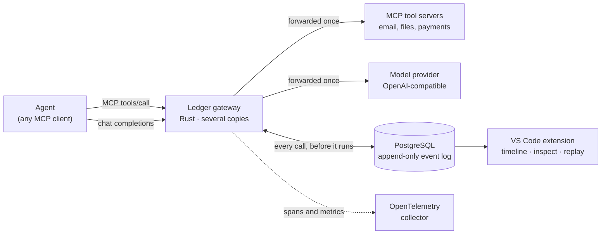

<h1 align="center">Ledger</h1>

<p align="center">
  <b>A crash-safe gateway and time-travel debugger for AI agents.</b><br>
  Every tool call and model call is recorded before it runs. Retries never send the same email twice.<br>
  Any run can be inspected step by step, forked onto another model, or replayed as a regression test.
</p>

<p align="center">
  <a href="https://github.com/CarlGergi/Ledger/actions/workflows/ci.yml"></a>
  
  
  
  
  
  
  
  
  
</p>

<p align="center">
  
  
  
</p>

## At a glance

| What was measured | Without Ledger | With Ledger | Reproduce |
| --- | --: | --: | --- |
| Duplicate side effects, 1,000 calls, 10% of replies lost after the tool ran | 108 | **0** | `make bench-duplicates` |
| Duplicate side effects, 1,000 calls, 30% of replies lost | 421 | **0** | `make bench-duplicates` |
| Unsafe calls that might have run, 30% of replies lost | repeated blindly | **301 flagged for a person, 0 repeated** | `make bench-duplicates` |
| Simulated runs with crashes, paused copies and lost messages | | **1,000,000 seeds, 0 invariant violations** (19.7 million calls, 10.6 million takeovers); 10,000 on every CI run | `make simulate` |
| Bugs deliberately injected into the gateway and store | | **111 of 111 caught by a test** | `make breakage` |
| Whole test suite under CPU starvation and three-way contention | | **230 runs, 0 failures** | `make soak` |
| Latency Ledger adds per call, median | | **3.1 to 4.5 ms** in a session's first 100 calls; 6.0 to 8.4 ms by call 1,000 | `make bench-overhead` |
| Calls per second, one gateway copy, 16 clients | | **528 to 828** | `make bench-overhead` |

Every number above comes from one command, and `make reproduce` runs all but the overhead benchmark, which needs a quiet machine. [Benchmarks](#benchmarks) has the full tables with the machine and its load. Overhead ranges are over four runs on a laptop with other apps running.

## Highlights

- **Write-ahead for agents.** Each call is committed to PostgreSQL before it is forwarded, and its answer before the agent gets it. Nothing reaches the agent that the log does not hold.
- **Safe retries.** Tools are classed by how safely they repeat. Retries are answered from the log, keyed calls reuse their idempotency key, and calls that might have run are flagged for a person, never run twice.
- **Several copies, one owner.** Leases with fencing tokens, checked in the statement that writes, so a paused copy cannot write after another has taken over.
- **Proven by simulation.** Three gateway copies, a store, tools and agents in one deterministic thread; any failing seed replays exactly.
- **Time travel.** A VS Code extension to step through any session, and forks that replay a run up to a step and go live on another model.
- **Regression replay.** Replay recorded runs on a new model with every tool answered from the log, and see the first step where behaviour changed.
- **Observable and deployable.** OpenTelemetry traces and metrics, graceful shutdown with health checks, a container image, and Azure Container Apps templates.

**Status:** milestones 1 to 5 are complete. Milestone 6 has tracing, the email demo, graceful shutdown and the Azure templates; the overhead benchmark and the deployment itself remain. See [Roadmap](#roadmap).

<details>
<summary><b>Contents</b></summary>

- [Quick start](#quick-start) · [How it works](#how-it-works) · [Configuration](#configuration) · [Inspecting the log](#inspecting-the-log)
- [VS Code extension](#vs-code-extension) · [Effect classes](#effect-classes) · [Retries and calls in doubt](#retries-and-calls-in-doubt) · [Several gateway copies](#several-gateway-copies)
- [Model calls](#model-calls) · [Forking a session](#forking-a-session) · [Regression replay](#regression-replay) · [Traces and metrics](#traces-and-metrics)
- [The email demo](#the-email-demo) · [Stopping and health checks](#stopping-and-health-checks) · [Deploying to Azure](#deploying-to-azure)
- [Benchmarks](#benchmarks) · [Simulation](#simulation) · [Testing](#testing) · [Layout](#layout) · [Current limits](#current-limits) · [Roadmap](#roadmap)

</details>

## Quick start

You need Rust 1.99 or newer, Docker, and for the optional checks, Node.js and Python 3.

```bash
make demo
```

This starts PostgreSQL, two example tool servers, and the gateway. It then runs a sample agent that writes a file, reads it back, and sends an email, and prints what was recorded:

```text
    1  00:13:01.482  files__write_file  request
    2  00:13:01.497  files__write_file  response to #1 (ok)
    3  00:13:01.501  files__read_file  request
    4  00:13:01.509  files__read_file  response to #3 (ok)
```

To point your own agent at it, run `make stack` and give the agent this MCP server URL:

```text
http://127.0.0.1:7100/mcp
```

## How it works



For each `tools/call`, the gateway does three things in order:

1. It commits the request to the log. If that fails, the call is not forwarded.
2. It forwards the call to the tool server, exactly once.
3. It commits the response to the log, then returns it to the agent. If that fails, the agent gets an error instead of the result.

So a tool cannot run without a record of the request, and nothing reaches the agent that the log does not also hold. Everything the agent saw can be replayed later.

The log enforces this in the schema, not only in the gateway:

- Each session's sequence numbers run 1, 2, 3, ... with no gaps, even under concurrent calls.
- `(session, sequence)` is unique, and a call can have only one recorded response.
- Updates, deletes, and truncates are rejected.

### What happens when something fails

| Failure | What the agent sees | What the log shows |
| --- | --- | --- |
| The database rejects the request | Error `-32050`; the tool does not run | Nothing |
| The tool reports failure | The tool's own error result | `tool_error` |
| The tool server rejects the call | The server's JSON-RPC error, unchanged | `rpc_error` |
| The tool server is unreachable | Error `-32052`, outcome unknown | `transport_error` |
| The tool server does not answer in time | Error `-32052`, outcome unknown | `timeout` |
| The tool name has no matching server | Invalid params error | `not_routed` |
| The database rejects the response | Error `-32051`; the tool may have run | A request with no response |
| The gateway is killed mid-call | Connection error | A request with no response |
| The agent cancels or hangs up mid-call | Nothing further | The outcome, recorded when the tool finishes |

A request with no response means the outcome is in doubt, and the log says so rather than guessing.

### Sessions

Calls are grouped into sessions, chosen in this order:

1. The `x-ledger-session` header.
2. The `session` URL parameter, as in `/mcp?session=run-42`.
3. The MCP transport session, which gives an unmodified agent one log per connection.

Only the first two survive a reconnect, because a transport session ends with its connection. Session IDs can use letters, digits, and `- _ . :`, up to 128 characters.

The newest MCP revision (2026-07-28) has no transport sessions. So Ledger answers `server/discover` the way an older server does, which sends clients back to the `initialize` handshake.

### Tool names

Agents see each tool as `<server>__<tool>`, such as `email__send_email`. Schemas and annotations pass through unchanged.

## Configuration

The gateway reads a TOML file; see [`config/ledger.toml`](config/ledger.toml).

| Key | Default | Meaning |
| --- | --- | --- |
| `listen` | `127.0.0.1:7100` | Address to serve on |
| `database_url` | none | Used when `DATABASE_URL` is not set |
| `call_timeout_secs` | `60` | How long a call waits for its tool, or for a database connection |
| `connect_timeout_secs` | `5` | How long a tool server has to accept a new connection |
| `lease_secs` | `30` | How long a session stays with this copy after its last append; see below |
| `shutdown_grace_secs` | `25` | How long a stopping gateway waits for running calls; see [Stopping and health checks](#stopping-and-health-checks) |
| `effect_overrides` | none | File correcting what tools claim about their effects, relative to this one |
| `allowed_hosts` | loopback only | `Host` values to accept |
| `[[upstream]]` | none | A tool server: `name` and `url` |
| `[model]` | none | An OpenAI-compatible model to proxy: `url`, `api_key_env`, `timeout_secs` (default `300`); see [Model calls](#model-calls) |
| `[telemetry]` | none | An OTLP/HTTP collector for traces and metrics: `otlp_endpoint`, `service_name` (default `ledger`), `metrics_interval_secs` (default `60`); see [Traces and metrics](#traces-and-metrics) |

## Inspecting the log

```bash
make sessions
```

```bash
make log SESSION=<id>
```

`ledger log <id> --json` prints full events, including arguments and results, one per line, and `ledger sessions --json` lists sessions the same way. `ledger in-doubt` lists every call flagged for a person (see below). `ledger fork` starts a fork of a session; see [Forking a session](#forking-a-session).

## VS Code extension

`vscode/` holds an extension that reads the log through the `ledger` command:

- **Timeline:** a Ledger view in the activity bar lists sessions, and under each one its calls, each with its status, retries and effect class. Calls flagged as in doubt show a warning icon.
- **Inspect:** selecting a call opens it as JSON: arguments, step, effect class, every retry and attempt with its idempotency key, and the answer.
- **Replay:** the play button on a session steps through it one event at a time, showing every call as it stood at that point. Alt+Right and Alt+Left move forward and back.

To install it:

```bash
make vscode-package
```

Then run **Extensions: Install from VSIX** on `vscode/out/ledger.vsix`. Set `ledger.command` to the `ledger` binary (for example the full path of `target/debug/ledger`), and `ledger.databaseUrl` if `DATABASE_URL` is not set where VS Code runs.

`make vscode` type-checks it against the VS Code API and tests its logic and its use of the `ledger` command, outside VS Code. Nothing tests it inside a running VS Code yet.

## Effect classes

Each tool gets a class that says how safely its calls can be repeated, and each request in the log records the class it was given and why.

| Class | Meaning | A tool gets it by |
| --- | --- | --- |
| `read_only` | Changes nothing | `readOnlyHint: true`, unless it also says `destructiveHint: true` |
| `idempotent` | Repeating it with the same arguments has no further effect | `idempotentHint: true` |
| `keyed` | Repeats with the same key take effect once | Declaring an `idempotency_key` input |
| `at_most_once` | Nothing makes a second run safe | Anything else, including having no annotations or not being listed |

Annotations are only claims made by the tool server, so a file named by `effect_overrides` in the config can correct them, and it always wins. `config/effects.toml` shows the format. A tool named after a server that is not configured stops the gateway at startup, because a typo there would silently leave a tool uncorrected. A misspelled tool name on a real server cannot be caught that way.

The gateway learns annotations from listings, whether an agent asked for them or the gateway needed them for a call. A server that is unreachable or stalled when asked costs the call up to `call_timeout_secs` of extra waiting.

The class decides what happens when a call may have to run twice; see the next section.

## Retries and calls in doubt

An agent that resends a call is told what happened the first time, rather than having the tool run again. A call counts as a retry only if it identifies the call it repeats, and its arguments match (compared by a SHA-256 of the arguments with object keys sorted):

1. **It names the same step,** in the `x-ledger-step` header or as `ledger/step` in its `_meta`, with the same tool and arguments. The same step with different arguments is refused.
2. **It has the same JSON-RPC id in the same transport session,** with the same tool and arguments. MCP forbids reusing an id, so a client doing so is resending.

A retry is logged, and then:

- **If the call is still running in this copy,** the retry waits for its answer.
- **If the call has a final answer,** the retry gets it from the log.
- **Otherwise the call is in doubt:** it was forwarded, and nobody recorded how it ended, so the tool may or may not have run. Ledger never simply runs it again. Instead it goes by the call's class:
  - **`read_only` and `idempotent`** calls run again.
  - **`keyed`** calls run again with the same idempotency key.
  - **Anything else** is answered with `-32052` and logged as `in_doubt`, flagging it for a person. It will never run again. `ledger in-doubt` lists flagged calls.

A copy that takes a session over treats every call left without a final answer as in doubt. Calls that are not safe to repeat are flagged straight away. Safe and keyed ones stay open for a retry to settle. If the old copy then finishes the call, it cannot log the outcome, so its agent gets `-32051` and the call stays in doubt. A copy whose response fails to log for any other reason leaves the call in doubt in the same way.

### Idempotency keys

A keyed tool declares an `idempotency_key` input, or another input named by `key_param` in the override file. The gateway fills it in with `ledger:<session>:<call>`, the same on every attempt at one call and different for every other call. It replaces any key the agent sent, and hides the input from the tool listing, so a model never chooses one. The key is logged with each response.

The demo's `send_email` takes a key: a repeated key returns the first message and sends nothing. `append_file` takes none, and is at most once.

**The trade-off.** Identical arguments on their own never make a retry, because an agent may well mean to send the same email twice, and both must go. So a retry is recognised only by its step or its request id. An agent that resends with a new id and no step gets the tool run again. Agents that number their steps, or resend with the same id, get exactly one run. The exception is after a takeover: any call left without an answer that is not safe to repeat is flagged as in doubt before anything else happens in the session, whatever the agent sends next.

## Several gateway copies

Copies of the gateway can share one database. Each session belongs to one copy at a time, through a lease in the database: a copy takes a session on its first call, and every append extends the lease by `lease_secs`. Another copy can take the session over only once the lease has expired, and taking it over gives it a higher fencing token.

Every append carries its copy's token, and the statement that writes the event also checks it. So a copy that was paused, perhaps for longer than its lease, cannot append once another copy has taken over, however sure it is that it still owns the session. Its calls fail with `-32050` before they reach a tool. Lease expiry uses the database's clock, the one clock every copy shares.

While a call runs, the copy renews its lease every quarter of `lease_secs`, so a call longer than the lease keeps the session.

Fencing protects the log, not the outside world. A copy that logged a request and then paused can still forward it when it wakes. What keeps that safe is the in-doubt rule above: the copy that takes over never runs such a call again unless its class says that is safe.

## Model calls

The gateway can also stand in for an OpenAI-compatible model, so one log holds what the model was asked, what it answered, and the tool calls that followed, in the order they happened. Point the agent's model client at the gateway instead of the provider:

```text
http://127.0.0.1:7100/v1                 with the x-ledger-session header
http://127.0.0.1:7100/s/<session>/v1     for clients that can only set a base URL
```

The session is the one the agent's tool calls use. `POST /chat/completions` is proxied to `[model] url`. A model call follows the tool-call rule:

1. The request is logged as a `model_request`, with a SHA-256 of the whole body. If that fails, the model is not asked, and the agent gets HTTP 503 with error `-32050`.
2. The request goes to the model once, with the lease renewed meanwhile.
3. The reply is logged as a `model_response`. If that fails, the agent gets HTTP 503 with `-32051` instead of the reply.
4. The agent gets the reply rebuilt from what was logged.

| What happened | What the agent gets | What the log shows |
| --- | --- | --- |
| The model answered | The answer | `ok`, with the status and body |
| The model returned an HTTP error | The same status and body | `rpc_error`, with the status and body |
| The model could not be reached | HTTP 502, error `-32052` | `transport_error` |
| The model did not answer within `timeout_secs` | HTTP 504, error `-32052` | `timeout` |

**Streaming.** A streamed reply (`"stream": true`) is read to the end and logged event by event, and only then sent to the agent as the same event stream. The log never holds less than the agent saw, at the cost of the agent receiving the first token only when the last one arrives.

**Credentials.** With `api_key_env` set, the gateway sends that key and ignores the agent's. Without it, the agent's `Authorization` or `api-key` header is passed on. No other header is passed on, and no key is ever logged. Requests whose `Host` or `Origin` is not allowed are refused, by the same rule as `/mcp`, so a web page cannot use the gateway's key through DNS rebinding.

**Model calls have no effects,** so they are never deduplicated, never in doubt, and never flagged when a copy takes a session over. An agent that asks again makes a new model call.

`make demo-model` runs the demo task decided by a scripted model, `reporter-1`, served by `model-server` on port 7103. Its replies depend only on the conversation, which keeps the tests repeatable. `reporter-2` and `reporter-3` differ from it on purpose, for testing replay against a new model.

## Forking a session

A fork runs an agent again from any step of a recorded session, on another model or with another system prompt, to see what would have changed. Everything before the step is answered from the recorded session's log, so the agent gets there exactly as it did the first time, and nothing runs twice.

```bash
ledger fork <session> --at <step> [--model <name>] [--system-prompt-file <file>] [--tools safe|replay|live] [--as <id>]
```

This prints the new session's id. Run the agent again under that session, through the gateway, for its tools and its model calls alike. `<step>` is a sequence number in the source's log (`ledger log`, or the step counter in the extension's replay). One past the last event replays the whole run.

How the fork answers each call:

- **Before the step,** each call, to a tool or to the model, is matched to a call the source made before the step, with the same kind, name and arguments. It gets that call's recorded answer, and nothing is forwarded. Each source call answers once. A call with no match means the agent has already gone another way, so the fork is not a fork of that run: a tool call gets error `-32053`, and a model call gets HTTP 409 with the same code.
- **From the step on,** model calls go to the model, as `--model` if given, with `--system-prompt-file` in place of the agent's system message if given. Tool calls depend on `--tools`:

| `--tools` | A call the source made, with the same arguments | A read-only call it did not make | Any other call |
| --- | --- | --- | --- |
| `safe` (default) | Answered from the source's log | Runs | Not run: the agent gets a tool error saying why |
| `replay` | Answered from the source's log | Not run | Not run |
| `live` | Runs | Runs | Runs |

So by default a fork can explore what a new model would do without sending a second email. Everything it does is logged in the fork's own session: answers taken from the source carry `replayed_from`, calls turned down are logged as `refused`, and live model calls record both the request the agent made and what was sent. `ledger log` starts with what the session is a fork of.

Which source calls have been used is read from the fork's own log on every call, so a fork carries on correctly after a crash or on another gateway copy. A session can become a fork only before it has recorded anything: `ledger fork --as` refuses a session that exists.

## Regression replay

Before switching an agent to a new model, replay recorded runs on it. A replay is a fork at the first step in `replay` mode: every model call goes to the new model, and every tool call is answered from the recorded log or turned down, so nothing real happens.

```bash
ledger replay <session> --model <new-model>     # prints the replay's session id
# run the agent again under that session, through the gateway
ledger compare <session> <replay>               # add --json for the full report
```

`ledger compare` reports the first step where the two runs act differently. What a run does is the tool calls it asks for, each with its arguments, then the model's final answer. Model calls are not compared one by one, because a new model may word its requests differently and still do the same thing. It also reports what each run cost: model calls, tokens as the model reported them, and tool calls run, answered from the log, or turned down.

For a whole suite, `ledger regress` does all three for every session in a file, against a running gateway:

```toml
model = "gpt-5-mini"
agent = ["my-agent", "--session", "{session}"]

[[run]]
session = "run-1"
args = ["--task", "Write the daily report."]
```

Each run's `args` follow the agent command, so the agent gets the same task as when the run was recorded. `--model` replays on another model than the file's, `--json` prints one report per run, and `--fail-on-divergence` makes any change, or any agent that fails, an error, for CI.

Results of `make regress`, which records three runs with the scripted `reporter-1` and replays them on each scripted model:

| Replayed on | Same | Diverged | Where | Tools run by the replays | Answered from the log | Turned down |
| --- | --: | --: | --- | --: | --: | --: |
| `reporter-1` | 3 | 0 | | 0 | 6 | 0 |
| `reporter-2` | 0 | 3 | Step 2: the same email with another subject | 0 | 3 | 3 |
| `reporter-3` | 0 | 3 | Step 2: reads the report back instead of emailing it | 0 | 6 | 3 |

The six recorded tool calls were never run again: each replay was answered from the log or turned down. The scripted models' token counts are a quarter of the characters they handle, not real tokens, so they are left out here.

## Traces and metrics

Ledger reports through OpenTelemetry, over OTLP/HTTP, to the collector named in `[telemetry]`, or to wherever the standard `OTEL_EXPORTER_OTLP_ENDPOINT` variable points. With neither set, it reports nothing.

**One span per call,** to a tool or to the model, as a server span. Names and attributes follow OpenTelemetry's conventions for MCP and generative AI where they have one: `tools/call <tool>` with `mcp.method.name` and `gen_ai.tool.name`, and `chat <model>` with `gen_ai.request.model`, `gen_ai.response.model`, `gen_ai.usage.input_tokens` and `gen_ai.usage.output_tokens`. Ledger's own attributes say where the call is in the log and what happened to it:

| Attribute | Value |
| --- | --- |
| `ledger.session`, `ledger.seq` | The session, and the call's sequence number in its log |
| `ledger.effect.class` | `read_only`, `idempotent`, `keyed` or `at_most_once` |
| `ledger.decision` | `new`, `retry_waited`, `retry_from_log`, `retry_rerun`, `retry_in_doubt`, `step_reused`, `replayed`, `fork_refused` or `fork_diverged` |
| `ledger.outcome` | What the agent got: `ok`, `tool_error`, `in_doubt`, `not_recorded`, `outcome_not_recorded`, and so on. Anything but `ok` also sets the span's error status and `error.type` |

If the agent sends a W3C `traceparent` header, or a `traceparent` in a tool call's `_meta`, the call's span joins the agent's trace, and a model call passes its own span on to the model as the parent. A tool call's span marks the moment it was forwarded.

**Metrics:**

| Metric | What it counts |
| --- | --- |
| `ledger.calls` | Calls, by `ledger.call.kind` (`tool` or `model`), `ledger.decision` and `ledger.outcome` |
| `ledger.call.duration` | Seconds per call, logging included, by kind and outcome |
| `ledger.in_doubt` | Calls flagged for a person, by `ledger.flagged.by` (`retry` or `takeover`) |
| `ledger.leases` | Sessions this copy took, and with `ledger.lease.takeover`, whether from another copy |
| `ledger.fenced` | Appends refused because another copy had taken the session |

On Ctrl-C the gateway sends whatever it still holds before it exits.

## The email demo

The case Ledger exists for: an email goes out, the answer is lost on the way back, and the agent sends it again.

```bash
make demo-agentmail
```

It runs one agent that sends one email and retries, with a fresh connection, when no answer comes. A proxy forwards the first call, lets the tool run, and then loses the answer. Three runs, each counting the emails AgentMail actually sent:

| Run | The agent | Emails sent |
| --- | --- | --: |
| Straight to the tool | Answered after 2 attempts | 2 |
| Through Ledger, answer lost on the way to the agent | Answered after 2 attempts | 1 |
| Through Ledger, answer lost on the way from the tool | Answered after 2 attempts | 1 |

In the second run, the retry names the same step, so Ledger answers it from the log. In the third, the call has no answer in the log, so it is in doubt. `send_email` takes an idempotency key, so Ledger sends it again with the same key, and AgentMail's own idempotency (`Idempotency-Key`) sends nothing new. Ledger's keys contain `:`, which AgentMail does not accept, so the tool server passes on a SHA-256 of each key instead: the same key every time for the same call.

Without credentials, the demo uses a local stand-in for AgentMail's API that keeps its documented rules for keys: a repeat returns the first message, a repeat with other content is a 409, and an invalid key is a 400. `make reproduce` always uses the stand-in. To send real email, four messages in all:

```bash
export AGENTMAIL_API_KEY=...            # an AgentMail key with message_send permission
export AGENTMAIL_INBOX=you@agentmail.to # an inbox of yours to send from
export AGENTMAIL_TO=you@example.com     # where the demo emails go
make demo-agentmail
```

The key is read only from the environment, never from a command line or the log.

## Stopping and health checks

On Ctrl-C or SIGTERM, the gateway stops being ready and turns new calls away with `-32050` (not recorded, not forwarded, so safe to send elsewhere). It keeps serving until every call already running has logged its answer, for up to `shutdown_grace_secs`, then sends any buffered telemetry and exits. A call still running after that is left with a request and no answer, in doubt, as after a crash. An agent whose call finishes during shutdown may lose its connection before the answer arrives. The answer is in the log, so a retry gets it.

| Path | Answers |
| --- | --- |
| `/healthz` | 200 while the process is up |
| `/readyz` | 200 while the gateway should get traffic: not shutting down, and its database answering. 503 otherwise |

## Deploying to Azure

`deploy/azure` holds Bicep templates and a script for Azure Container Apps, with the log in Azure Database for PostgreSQL (Flexible Server, PostgreSQL 17, Burstable B1ms) and traces in Application Insights. The `Dockerfile` builds the gateway's image.

```bash
export LEDGER_UPSTREAMS=deploy/azure/upstreams.example.json   # your tool servers
export LEDGER_POSTGRES_PASSWORD=...
deploy/azure/deploy.sh preview   # compiles the templates and shows what would change; creates nothing
deploy/azure/deploy.sh deploy    # builds the image in Azure, then deploys
```

What it sets up:

- A container registry, and the image built in it with `az acr build`, so nothing is pushed from your machine. The app pulls it with a managed identity, not a password.
- The gateway as a container app with an HTTPS endpoint. Its config is a secret mounted as a file, with `allowed_hosts` set to the app's own address, and `DATABASE_URL`, with TLS, is a secret too. Probes use `/healthz` and `/readyz`, and the platform's 30-second stop grace is longer than the gateway's own 25.
- The environment's managed OpenTelemetry agent, which forwards the gateway's traces to Application Insights. It cannot forward metrics there, so metrics need an OTLP destination of their own.

**One replica.** An MCP transport session lives in the memory of the copy that opened it, and Container Apps cannot route requests by `Mcp-Session-Id`, so more replicas would break sessions. Several copies sharing a database work today (see [Several gateway copies](#several-gateway-copies)), but each needs its own address, or a router that knows about MCP sessions.

**Not yet verified:** the templates have not been compiled, and the image has not been built. Neither has been deployed.

## Benchmarks

### Duplicate side effects

One agent makes 1,000 calls, one email or one appended line each, and retries a call until it is answered, up to 5 attempts, as agents commonly do. A proxy loses each tool call's answer with a fixed probability, after the tool has run, from a seeded generator, so a run repeats exactly. Effects are counted at the tool, never from what the agent believes. `make bench-duplicates` runs both tables.

Measured 2026-11-12, 02:29 to 02:31 UTC, on a Mac17,7 (Apple M5 Max, 18 cores, 36 GB, macOS), load average 14.4 at the start and 9.6 at the end, with other projects building. The counts do not depend on load: the losses are seeded and the calls run one at a time.

**10% of answers lost:**

| Arrangement | Tool | Answers lost | Effects | Duplicates | Answered | Gave up | Answered from the log | Run again with the same key | Flagged in doubt |
| --- | --- | --: | --: | --: | --: | --: | --: | --: | --: |
| Straight to the tool | email (keyed) | 108 | 1,108 | **108** | 1,000 | 0 | | | |
| Ledger, answer lost on the way to the agent | email (keyed) | 108 | 1,000 | **0** | 1,000 | 0 | 108 | 0 | 0 |
| Ledger, answer lost on the way from the tool | email (keyed) | 108 | 1,000 | **0** | 1,000 | 0 | 0 | 99 | 0 |
| Straight to the tool | append (no key) | 108 | 1,108 | **108** | 1,000 | 0 | | | |
| Ledger, answer lost on the way to the agent | append (no key) | 108 | 1,000 | **0** | 1,000 | 0 | 108 | 0 | 0 |
| Ledger, answer lost on the way from the tool | append (no key) | 103 | 1,000 | **0** | 897 | 103 | 309 | 0 | 103 |

**30% of answers lost:**

| Arrangement | Tool | Answers lost | Effects | Duplicates | Answered | Gave up | Answered from the log | Run again with the same key | Flagged in doubt |
| --- | --- | --: | --: | --: | --: | --: | --: | --: | --: |
| Straight to the tool | email (keyed) | 425 | 1,421 | **421** | 996 | 4 | | | |
| Ledger, answer lost on the way to the agent | email (keyed) | 425 | 1,000 | **0** | 996 | 4 | 421 | 0 | 0 |
| Ledger, answer lost on the way from the tool | email (keyed) | 425 | 1,000 | **0** | 996 | 4 | 0 | 289 | 0 |
| Straight to the tool | append (no key) | 425 | 1,421 | **421** | 996 | 4 | | | |
| Ledger, answer lost on the way to the agent | append (no key) | 425 | 1,000 | **0** | 996 | 4 | 421 | 0 | 0 |
| Ledger, answer lost on the way from the tool | append (no key) | 301 | 1,000 | **0** | 699 | 301 | 903 | 0 | 301 |

How to read it: straight to the tool, every lost answer becomes a second email. Through Ledger, a retry after an answer lost on the way to the agent is answered from the log. A keyed call whose answer was lost on the way from the tool runs again with the same key, which the tool honours. A call with no key in that position may or may not have run, so Ledger flags it for a person and tells the agent the outcome is unknown, rather than repeat it. The 4 calls that gave up at 30% lost five answers in a row; 0.3⁵ of 1,000 is 2.4.

### Overhead

`make bench-overhead` makes the same read-only tool call straight to the tool server and through Ledger: 1,000 calls one at a time in a fresh session, after 100 warm-up calls in another, then 16 clients making 100 calls each for calls per second. Through Ledger, a call includes deciding what it is, reading the session's log, two commits to PostgreSQL, and the forward.

Four runs, 2026-11-12 02:39 to 02:42 UTC, on a Mac17,7 (Apple M5 Max, 18 cores, 36 GB, macOS), PostgreSQL 17 in Docker (OrbStack) on the same machine. **The machine was not idle:** iOS simulators, an Android emulator, a Python process and system services used 4 to 5 cores, and the load average was between 7.8 and 12.0, which is why the runs vary.

| Run | Load at start | Straight to the tool, p50 / p99 | Through Ledger, p50 / p99 / max | First 100 calls, median | Calls 901 to 1,000, median | Calls/s through Ledger (straight) |
| --- | --: | --: | --: | --: | --: | --: |
| 1 | 12.0 | 0.19 / 0.50 ms | 5.29 / 12.05 / 17.2 ms | 3.44 ms | 6.04 ms | 797 (16,276) |
| 2 | 9.8 | 0.26 / 0.62 ms | 5.72 / 13.19 / 21.4 ms | 3.79 ms | 6.65 ms | 713 (20,683) |
| 3 | 9.0 | 0.23 / 0.56 ms | 4.60 / 10.91 / 22.8 ms | 3.08 ms | 6.08 ms | 828 (18,012) |
| 4 | 7.8 | 0.21 / 0.53 ms | 6.68 / 13.42 / 22.9 ms | 4.46 ms | 8.42 ms | 528 (18,573) |

What it shows:

- **Ledger adds about 3 to 4.5 ms per call early in a session.** Most of that is two durable commits to PostgreSQL, which here sits in a VM, and a second HTTP hop.
- **The cost grows with the session:** about 6 to 8.4 ms by call 1,000, because recognising a retry reads the whole session's log (see [Current limits](#current-limits)). Indexing the log by step and request id would make it flat.
- **One copy handles 528 to 828 calls per second** with 16 clients, against 16,000 to 21,000 straight to the tool. Each call is two commits; copies share the database, so more copies add throughput until PostgreSQL is the limit.
- **Every call opens a TCP connection,** as the MCP HTTP client does: one straight to the tool, two through Ledger. The sizes above are kept within what macOS's local ports allow at these rates.

## Simulation

`make simulate` runs 10,000 seeds of a deterministic simulation. Each seed sets up three gateway copies sharing one store, a tool server, and two to five agents, all in one thread. Every random choice comes from one generator seeded by the seed, and every timer runs in simulated time. So a seed replays exactly, and a failing one prints the command that replays it with a full trace:

```bash
cargo run --release -p ledger-sim -- --seed <n> --trace
```

The gateway is the real one, driven through `Gateway::call`. The store is the in-memory store, which `crates/ledger-store/tests/conformance.rs` holds to the PostgreSQL store: one suite runs against both, in CI too, so any difference between them fails a test. The HTTP and MCP transport layer is outside the simulator, and so is the model proxy. The integration tests cover both, against real servers.

**Faults injected,** at rates each seed scales by a factor from 0.5 to 4:

- copies killed at any point, including just after a write and before learning it succeeded
- copies paused for longer than their lease, then woken still believing they own their sessions
- writes that fail, and writes that commit but whose acknowledgement is lost
- requests lost, delayed or duplicated on the way to a copy, and answers lost on the way back
- tool servers that refuse connections, hang, or run the tool and lose the answer
- a tool that claims to be read-only but is not, corrected by the override file, and another that is not corrected

Agents come in three kinds: ones that number their steps, ones that resend with the same request id, and ones that resend with a new id and no step.

**Invariants checked after every run,** once a healthy copy has taken every session over:

1. Every session's log is gapless, every answer and retry links to an earlier call of the same tool, no call has two final answers, and fencing tokens never go backwards along the log.
2. Nothing that is not safe to repeat is left without a final answer.
3. No at-most-once or keyed effect happens twice, for agents ledger can recognise.
4. A call flagged as in doubt never runs again.
5. Every answer an agent was given is in the log.
6. A call whose outcome went unrecorded (`-32051`) never runs again if it is not safe to repeat.

Repeats from agents that resend with a new id, and from the uncorrected lying tool, are counted rather than treated as failures. They are the documented limits: ledger cannot tell such a resend from a new call, and cannot know a tool lies unless told.

`make breakage` also checks the simulator itself, by injecting seven bugs into the gateway and store and requiring the seed test to catch each.

Results of `make simulate`, which takes a few seconds:

| Seeds | Failed | Calls | Retries | Tool effects | Takeovers | Flagged in doubt | Repeats from new-id resends | Repeats from the uncorrected lie |
| --: | --: | --: | --: | --: | --: | --: | --: | --: |
| 10,000 | 0 | 197,532 | 21,573 | 187,885 | 106,046 | 9,570 | 3,384 | 752 |

The simulator has not found a bug in Ledger itself. What it did find was a blind spot of its own: its step-numbering agents never reconnected, so rule 2 caught their retries whatever rule 1 did. Its own check against injected bugs is what showed this.

## Testing

| Command | What it does |
| --- | --- |
| `make test` | Runs every test against real PostgreSQL |
| `make breakage` | Breaks each guarantee in turn and checks that the test protecting it fails |
| `make simulate` | Runs 10,000 seeds of the deterministic simulation |
| `make interop` | Drives the gateway with the official TypeScript MCP client, configured only with a URL |
| `make regress` | Records three runs, replays them on each scripted model, and reports where each changed |
| `make bench-duplicates` | Counts duplicate side effects with and without Ledger, at 10% and 30% of answers lost |
| `make bench-overhead` | Latency and throughput Ledger adds; only on a quiet machine, so not part of `make reproduce` |
| `make agentmail-local` | The email demo against the local stand-in for AgentMail |
| `make vscode` | Type-checks and tests the VS Code extension |
| `make reproduce` | Runs all of the above except the overhead benchmark, plus lint |
| `make soak` | Repeats the whole suite under load, and fails on any failed run, PostgreSQL reset, or leftover database. About 30 minutes on a busy machine, so it is not part of `make reproduce` |

Each database test gets its own randomly named database, so test runs can overlap on one server, as long as each has its own `CARGO_TARGET_DIR`: even with nothing to build, `cargo test` relinks the binaries that another run's tests may be starting. A killed test run can leave databases behind; `make db-reset` clears them, along with all recorded sessions.

A test that restarts a server reserves its port from below the range the kernel hands out by itself, so while the server is down, connections are refused and nothing else can be given the port.

No test needs real work to finish inside a limit a loaded machine could miss. Limits on real work are 120 seconds, which only a failing test reaches, and short limits appear only on things that never answer, where firing late cannot change the result.

### Flakiness

The suite once failed intermittently. Each cause was traced and fixed, with no retries or sleeps to hide it:

1. **The test harness could deadlock.** `#[sqlx::test]` gives all of a test binary's pools one shared budget of connection permits, and a pool only returns its share once its last clone is dropped. Dropping a test's database needs a permit from that same budget, so finished tests that left a server running could wait on each other until sqlx's 30-second acquire timeout. Tests now get their databases from `ledger-testkit`, where every pool has its own small cap.
2. **Overlapping test runs destroyed each other's databases.** `#[sqlx::test]` names a database after the test's path, so a second run on the same server dropped the first run's databases. `ledger-testkit` names each one randomly.
3. **The Docker health check reset PostgreSQL.** A health check that timed out left its `pg_isready` running. As PID 1, PostgreSQL adopted that orphan, took it for one of its own backends, and on its non-zero exit restarted every connection as if after a crash. The container now runs under an init process, which adopts orphans instead.

Running out of connections looked like the obvious cause, and measuring showed it was not: the peak stays far below the server's limit of 300.

`make soak` repeats the suite under those conditions, and prints the machine and its load with the results. The CPU-starved runs sit at the lowest priority, beneath two busy processes per core, so everything else on the machine comes first. This run shared the machine with other projects' builds:

Machine: Mac17,7, Apple M5 Max, 18 cores, 36 GB, Darwin 27.0.0

| Condition | Suite runs | Failed | Median | Slowest | Peak connections | PostgreSQL resets | Load, start to end |
| --- | --: | --: | --: | --: | --: | --: | --: |
| One run at a time | 40 | 0 | 5.4s | 12.6s | 31 | 0 | 13.1 to 8.3 |
| Three runs at once | 180 | 0 | 12.6s | 20.2s | 92 | 0 | 5.2 to 11.1 |
| Starved of CPU | 10 | 0 | 41.1s | 128.6s | 49 | 0 | 5.3 to 151.1 |

0 failed runs, 0 PostgreSQL resets, 0 test databases left behind.

## Layout

| Path | Contents |
| --- | --- |
| `crates/ledger-store` | Event model, the `EventStore` trait, PostgreSQL and in-memory stores, migrations, the conformance suite |
| `crates/ledger-gateway` | The gateway and the `ledger` command |
| `crates/ledger-sim` | The deterministic simulation |
| `crates/ledger-bench` | The duplicate-effects and overhead benchmarks |
| `crates/ledger-testkit` | A private, automatically dropped database and reserved ports for each test |
| `crates/ledger-tools` | Example tool servers (email, files, and AgentMail with a local stand-in for its API), a scripted OpenAI-compatible model, and a proxy that loses answers |
| `crates/sample-agent` | MCP clients: a scripted one, one that a model drives, and one that resends an email until answered |
| `vscode` | The VS Code extension |
| `interop/typescript` | Interoperability check with the official client |
| `scripts` | The breakage check, the soak, the regression replay demo, and a helper that runs the full stack |
| `.github/workflows` | CI: lint and every test, against PostgreSQL |
| `deploy/azure`, `Dockerfile` | Azure Container Apps deployment, and the gateway's image |

## Current limits

- **Retry detection reads the whole session's log** for each call. Measured, that takes a call from about 3 to 4.5 ms early in a session to 6 to 8.4 ms by call 1,000 (see [Overhead](#overhead)): fine for agent sessions of hundreds of calls, not for millions.
- **An agent that resends with a new request id and no step is not recognised as retrying,** so the tool runs again. See "The trade-off" above.
- **A crashed copy's sessions wait for its leases.** A restarted copy cannot record in them for up to `lease_secs`, because it cannot tell itself apart from a paused original.
- **No authentication.** Keep the gateway on loopback or behind something that authenticates.
- **Tools only.** Resources and prompts are not passed through, and neither are progress notifications.
- **A fork needs an agent that asks the same things when given the same answers.** One whose requests carry timestamps, random ids or anything else that changes between runs goes another way at its first call, and the fork refuses it with `-32053` rather than pretend to replay it.
- **Chat completions only.** The model proxy handles `POST /chat/completions`, not the Responses API, embeddings, or `GET /models`.
- **Streamed replies arrive all at once,** because each is logged in full before it is sent, so the agent loses streaming's early first token. The alternative keeps both: log each chunk as an event of its own, then forward it, so the agent streams and the log still leads by one chunk. A copy that died mid-stream would leave a reply with no end, which replay would have to treat as cut off. Planned only after milestone 6, if there is time.
- **The agent's `_meta` is logged but not forwarded,** because it describes the agent's exchange with the gateway.
- **Clients that only speak MCP 2026-07-28** cannot connect, because they have no handshake to fall back to.

## Roadmap

1. ~~Pass-through gateway and event log~~
2. ~~Effect policy from MCP annotations, deduplication, idempotency keys, leases with fencing tokens~~
3. ~~Deterministic simulation testing with fault injection~~
4. ~~VS Code extension: timeline, inspect, replay~~
5. ~~Model proxy, forking a session at any step, regression replay against a new model~~
6. Benchmarks, OpenTelemetry, Azure deployment, a real email demo: tracing, the email demo, graceful shutdown, the duplicate-effects benchmark and the Azure templates are done; the overhead benchmark and the deployment itself remain
